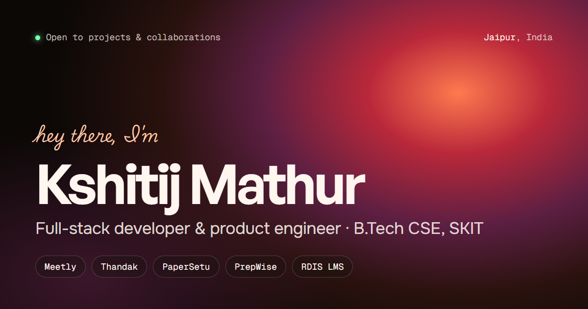

# Kshitij Mathur · Portfolio

**Live:** [kshitij-mathur.vercel.app](https://kshitij-mathur.vercel.app/)

My personal portfolio: an animated WebGL gradient site with my projects, live coding stats and a small admin dashboard for keeping it up to date.



## Features

- **Live data:** problem-solving stats from Codolio (LeetCode, GfG, CodeChef, Codeforces, Code360) and recent commits from the GitHub API, cached in the browser, with baked-in fallbacks
- **Project case studies:** Meetly, Thandak, PaperSetu, PrepWise and RDIS LMS, each with an animated canvas preview
- **Motion:** Three.js fluid gradient background, GSAP scroll animations, smooth scrolling, colour palettes and a custom colour picker
- **Works on phones:** mobile layout, plus a fallback if scripts or fonts load slowly
- **Search and AI discoverability:** meta and Open Graph tags, schema.org JSON-LD (Person, projects, FAQ), `sitemap.xml`, `robots.txt` and `llms.txt`
- **Admin dashboard:** edit projects, experience, services, tools, side projects and the resume without touching code

## Stack

HTML, CSS, JavaScript · Three.js · GSAP · Lenis · Canvas 2D · Node.js and Express (admin)

## Structure

```
site/     the static website (deployed to Vercel, root directory "site")
server/   Express server + admin dashboard for editing content
```

## Updating content

```bash
cd server
npm install
npm run set-password   # first time only
npm start              # admin at http://localhost:3000/admin
npm run deploy         # export edits to site/, commit and push
```

Vercel redeploys automatically after the push. More details are in [server/README.md](server/README.md).

## Contact

[mathur.kshitij08@gmail.com](mailto:mathur.kshitij08@gmail.com) · [LinkedIn](https://www.linkedin.com/in/kshitijmathur08/) · [GitHub](https://github.com/Kmathur08)
